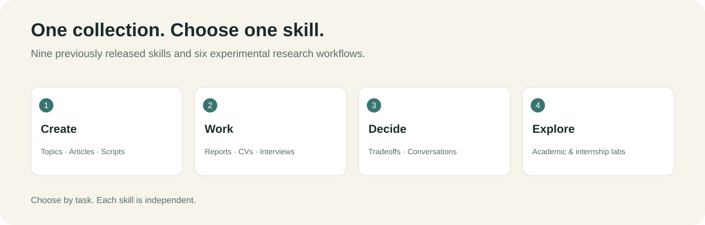
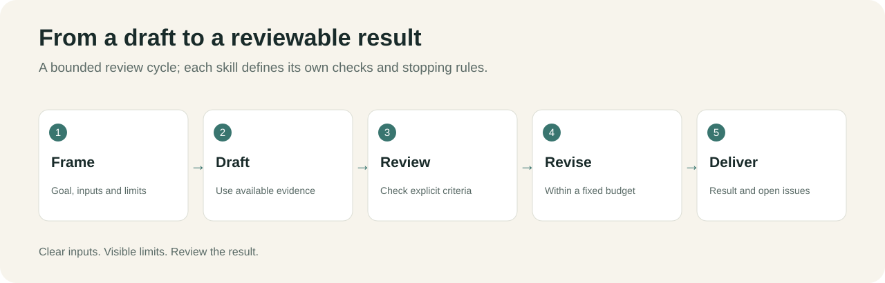

# Loop Skills · 让每一次修改都有依据


[English](README.en.md) · [如何选择](docs/choose-a-skill.md) · [场景示例](docs/scenarios.md) · [安装](docs/installation.md) · [验证与限制](docs/validation.md)

面向内容创作、职场沟通、决策与学术准备的一组独立 Agent Skills。先把目标和材料说清楚，再形成草稿、按标准检查、有限修订，最后交付结果与尚未解决的问题。

**选择一款即可开始。** 你不需要安装全套，也不需要接受统一的自动工作流。每款保留自己的输入要求、资源和停止条件。

> 本仓集中提供十五款产品的源码与独立下载。九款保留已有运行版本，六款为实验性产品。本次是文档与分发整理，新分发尚未完成双宿主行为验证，不代表新的功能验收。

[下载独立产品包](https://github.com/steven-pku/loop-skills/releases/tag/source-2026.10.22) · [迁移与恢复](docs/migration.md)



## 从你的问题开始

| 我想做什么 | 提供什么 | 得到什么 | 产品版本或状态 |
| --- | --- | --- | --- |
| [选题筛选](skills/loop-topic-picker) | 受众、账号目标、备选题目和可核实来源 | 选题比较与 Topic Brief | 0.4.1 |
| [观点长文](skills/loop-article-writer) | 文章目标、读者、核心观点、来源或现稿 | 长文、逐项诊断与有限修订 | 0.3.0 |
| [口播脚本](skills/loop-script-writer) | 讲述目标、现有素材、平台和目标时长 | 口播稿、开场诊断与时长调整建议 | 0.3.1 |
| [内容复盘](skills/loop-content-audit) | 已发布内容与用户提供的后台数据，或待审复盘报告 | 证据分级、诊断和有限改进建议 | 0.3.1 |
| [工作汇报](skills/loop-report-writer) | 任务记录、产物、反馈、成果证据和汇报对象 | 成果账本、周报、述职或晋升材料 | 0.3.1 |
| [简历表达](skills/loop-resume-writer) | 真实经历、目标岗位和可提供的成果证据 | 事实账本、岗位匹配和中文简历表述 | 0.3.4 |
| [面试准备](skills/loop-interview-writer) | 真实经历账本、岗位信息和需要练习的问题 | 自我介绍、经历故事、追问与反问准备 | 0.2.3 |
| [关键对话](skills/loop-negotiation) | 明确的对话情境、目标、底线和真实替代方案 | 准备 Brief、话术卡和受约束的模拟 | 0.4.2 |
| [重要决策](skills/loop-decision) | 候选方案、约束、已有证据和可逆性 | 简短判断或完整决策备忘录 | 0.3.1 |
| [论文选题可行性](labs/thesis-feasibility-gate) | 已有题目、学科、数据获取条件、方法和时间 | 可行性诊断、缩题方向与最小完成路径 | 实验性 |
| [问卷发放前检查](labs/survey-preflight-loop) | 一般社科问卷草稿、研究问题、样本与知情说明 | 题项、流程、抽样和分析准备度的问题清单 | 实验性 |
| [导师反馈整理](labs/advisor-feedback-loop) | 导师反馈原文、论文位置与已完成修改证据 | 意见到动作的映射、修改计划与关闭检查 | 实验性 |
| [学术 AI 使用记录](labs/academic-ai-ledger) | 适用政策与真实发生的 AI 使用记录 | 政策对照、使用账本与披露草稿 | 实验性 |
| [实习岗位作品](labs/internship-work-sample-loop) | 运营岗位要求、已有能力和可用公开材料 | 个人项目计划、作品证据和展示说明 | 实验性 |
| [实习成果整理](labs/internship-evidence-loop) | 本人任务、产物、反馈及允许留存的脱敏证据 | 行动、产物、结果和证据的对应账本 | 实验性 |

九款已发行产品位于 `skills/`；六款实验性产品位于 `labs/`。实验室里存在已知问题和验证缺口，不作为默认安装集合。版本号属于单款产品，不代表整套同时完成了行为测试。

## 先试一个小问题

如果你有一段文字，先试 Article Writer 的 `QA Only`，不用从完整长文开始：

```text
使用 loop-article-writer 的 QA Only。
请检查：所有人都应该每天五点起床，因为成功人士都这样做。
先指出推理与证据缺口，不直接替我补充研究或数据。
```

这是教学请求，不是已经执行的测试。检查输出是否区分“给定观点”“待核事实”和“推理问题”，并保留缺失依据。其他场景见[六组示例](docs/scenarios.md)。

## Loop 如何工作



“Loop”是一种有终点的修订方式。产品先确认任务是否适用，再使用自己的检查标准；达到本轮修订上限、缺少必要材料或遇到超出范围的请求时，应停下并解释原因。评分帮助定位问题，不能替代事实核验，也不能授权发布或操作外部账号。

## 不同产品怎样配合

选题可以为文章或脚本提供材料；简历中的真实经历账本可以帮助面试准备。交接由你发起，下一款仍要重新确认范围与依据，不自动继承上一款的评分、真实性判断或行动权限。

## 安装与升级

下载一款完整目录，并在目标宿主的新会话中显式调用。目录复制、摘要与恢复检查已完成；模型实际加载与行为仍待验证，详见[安装说明](docs/installation.md)。保留已有修改；下载、源码与问题反馈集中在本仓。

## 实验室

论文与实习产品帮助组织材料、建立证据与发现问题，不代替导师、伦理审查、招聘判断或学校政策。已知问题列在各产品的 `REVIEW.md`。不要把可阅读源码理解为通过了真实使用验收。

## 贡献与许可

[贡献指南](CONTRIBUTING.md) · [安全与隐私](SECURITY.md) · [MIT](LICENSE)。反馈时请提供产品名称、固定版本、宿主和脱敏的最小复现。
